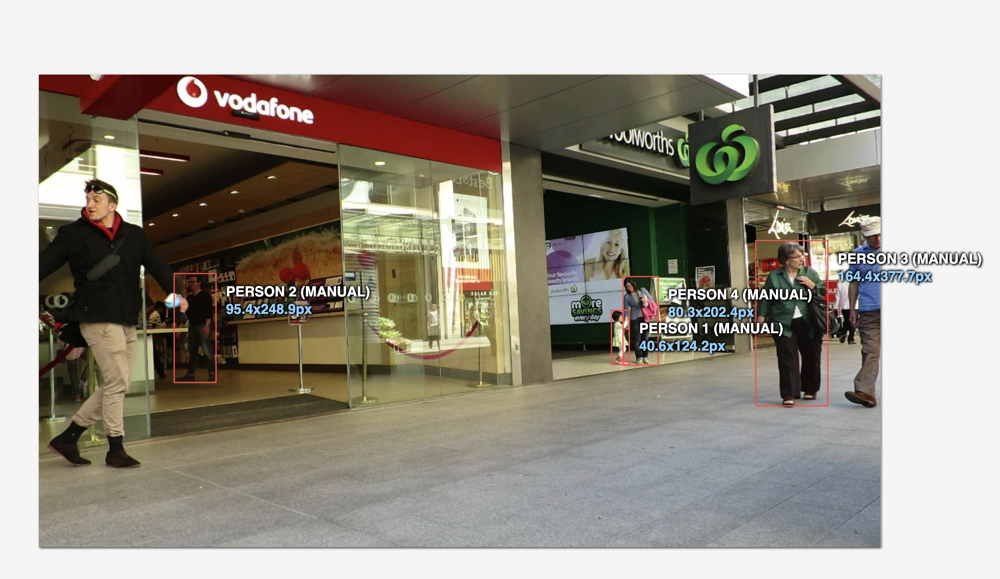
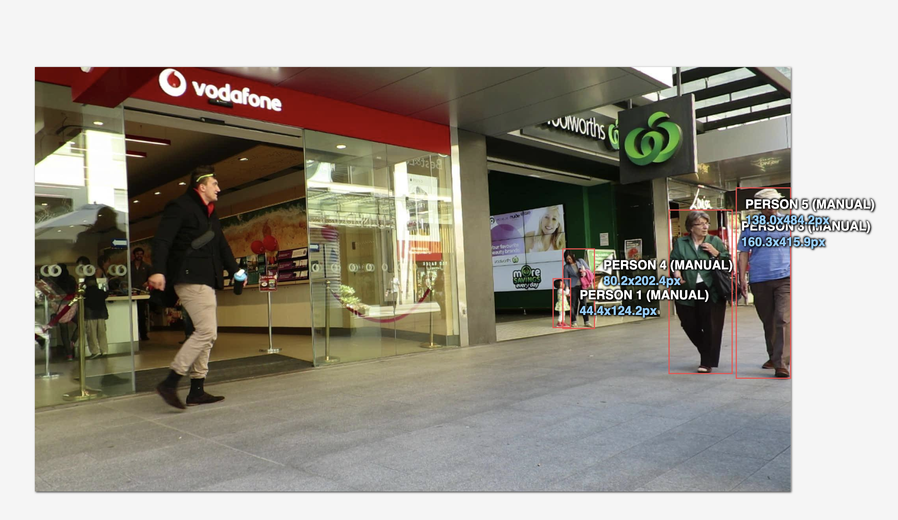
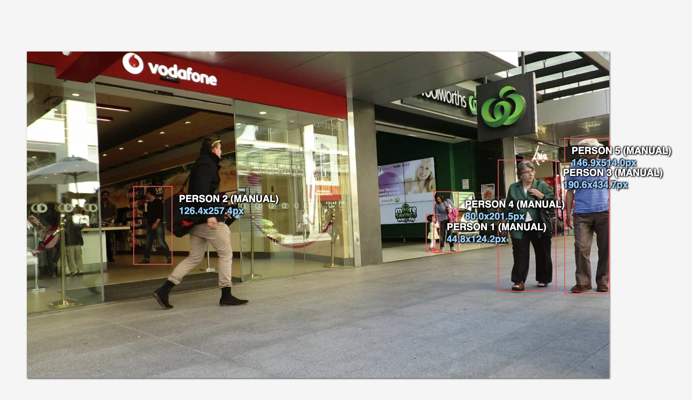

# Báo cáo cá nhân — LeTienBinh-2A202603346

Đoạn video: MOT17-09, 150 frame (frame 1–150), nguồn MOTChallenge, giấy phép CC BY-NC-SA 3.0.

## 0. Thông tin học viên

- Họ tên: Lê Tiến Bình
- MSSV: 2A202603346
- Mã đề (A/B/C): B (P1–P5 = MOT17 ID 1, 19, 20, 21, 22)
- Email: binh04092004@gmail.com
- Link repository: https://github.com/Cily49/K5-L2-DAY05-LeTienBinh-2A202603346-MOTTracking
- Giờ bắt đầu: 16:30 
- Giờ kết thúc: 18:30 

## 1. Xem trước đoạn video (CP0)

Ghi **trước khi vẽ**, mỗi người một dòng.

| Mã | Frame xuất hiện | Frame cuối thấy được | Rẽ / dừng / đổi tốc độ ở frame | Bị che ở frame | Ghi chú |
|---|---|---|---|---|---|
| P1 | 0 | 149 | Đi chậm lại ~89–100; quay ngược sang trái ~105–130 | 27–53 (khuất hẳn 40–48) | Người áo tối trong cửa hàng Vodafone, sau cửa kính; bị người áo khoác đen đi sát camera che |
| P2 | 0 | 149 | Tăng tốc ~100; lại gần camera, box to dần từ ~100 | Không | Bà áo khoác xanh, đi từ phải sang trái về phía camera; cuối đoạn đi sát P3 |
| P3 | 40 | 149 | Tăng tốc ~90; lại gần camera, box to dần | Không | Ông áo xanh dương, đội mũ, vào khung từ mép phải ở frame 40 |
| P4 | 0 | 146 | Đi sang phải 0–30; dừng đứng yên ~40–104 | 105–109, 135–146 (khuất hẳn 110–134) | Bé gái đi cạnh mẹ (P5) trước Woolworths; hai box chồng nhau |
| P5 | 2 | 104 | Đi sang phải 2–30; dừng đứng yên ~40–94 | 94–104 | Người mẹ cầm túi hồng, đứng cạnh P4; khuất từ frame 105 |

## 2. Keyframe và thời gian (CP1, CP4)

Số keyframe lấy từ kết quả `src/check_submission.py`.

| Mã | Số keyframe | Keyframe ở frame | Số frame có mặt | Keyframe / 100 frame | Thời gian (phút) | Chỗ khó |
|---|---|---|---|---|---|---|
| P1 | 62 | 0, 7, 10, 12, 13, 15, 17–21, 27, 31–36, 39, 49, 50, 53, 54, 60, 63, 64, 66, 71, 77–85, 87–89, 92–100, 104, 107, 109, 112–114, 119, 124, 130, 140, 144, 145, 149 | 141 | 44.0 | 30 | Đoạn che 27–53 và đoạn đi chậm, quay đầu 89–130: nội suy trôi, phải chỉnh gần như từng frame |
| P2 | 57 | 0, 8–10, 12, 14–18, 20, 21, 23, 24, 26, 30, 36, 43, 44, 49, 57, 61, 62, 68, 72, 73, 77, 79, 83, 88, 90, 92, 94, 99, 103, 105, 107, 109, 110, 112, 116, 119, 120, 122, 125, 127, 131, 133, 135, 137, 139, 141–143, 145, 148, 149 | 150 | 38.0 | 20 | Box to dần nhanh khi lại gần camera; cuối đoạn đi sát P3, dễ ôm nhầm |
| P3 | 27 | 40, 44, 51, 57, 60, 64, 69, 73, 77, 88, 91, 95, 97, 101, 105, 106, 109, 114, 120, 127, 130, 134, 139, 141, 144, 148, 149 | 110 | 24.5 | 15 | Vào khung từ mép phải ở frame 40, lúc đầu chỉ thấy một phần người |
| P4 | 36 | 0, 2, 3, 5, 6, 8, 9, 12, 15, 18–21, 25, 32, 34, 40, 44, 45, 55, 66, 74, 93, 101, 105–109, 135, 137–142 | 122 | 29.5 | 12 | Người nhỏ, đứng sát mẹ; quyết định cùng ID sau đoạn khuất 25 frame (110–134) |
| P5 | 11 | 2, 4, 10, 17, 21, 23, 36, 45, 64, 94, 103 | 103 | 10.7 | 10 | Đứng yên lâu nên ít keyframe; cần chú ý đoạn bị che 94–104 |
| **Tổng** | 193 |  | 626 | 30.8 | 87 |  |

Keyframe / 100 frame của cả bài = tổng keyframe ÷ tổng số frame có mặt × 100 = 193 ÷ 626 × 100 = 30.8

Bạn đặt keyframe nhiều nhất ở người nào? Vì sao (người đó rẽ, dừng, lại gần camera hay bị che)?

P1 có nhiều keyframe nhất (62 keyframe, 44,0 / 100 frame). P1 đứng sau cửa kính Vodafone và bị người mặc áo khoác đen đi ngang sát camera che từ frame 27 đến 53. Quanh đoạn che, box phải chỉnh gần như từng frame để vẫn bao toàn thân ước lượng. P1 cũng đi chậm và đổi tốc độ nhiều lần trong cửa hàng (keyframe dày ở frame 77–100), nên nội suy tuyến tính bị lệch. P5 ít keyframe nhất (11) vì chỉ đi thẳng đều ở đầu đoạn, sau đó đứng yên cạnh P4 từ khoảng frame 40, rồi khuất ở frame 105.

## 3. Đoạn bị che (CP2)

Người bị che: `P1`

| Mốc | Frame |
|---|---:|
| Bắt đầu bị che một phần (bật `occluded`) | 27 |
| Mất hẳn (bật `outside`) | 40 |
| Hiện lại (tắt `outside`) | 49 |
| Thấy rõ trở lại (tắt `occluded`) | 54 |

- Thời gian khuất hẳn: 9 frame (40–48) = 0,3 giây.
- Quyết định: giữ cùng ID.
- Lý do (trả lời 3 câu: khuất bao lâu so với 60 frame, ngoại hình có khớp, chỗ hiện lại có đúng hướng và tốc độ):

1. P1 chỉ khuất hẳn 9 frame (0,3 giây), nhỏ hơn nhiều so với ngưỡng 60 frame (2 giây) của lớp, nên phải giữ cùng ID.
2. Ngoại hình khớp: người hiện lại vẫn mặc áo tối màu và quần jean, cùng dáng người và kích thước box (khoảng 95–126 px rộng, 250 px cao).
3. P1 hiện lại ngay sau cửa kính, gần chỗ vừa bị che, cùng hướng đi sang phải với tốc độ chậm như trước. Nguyên nhân che là người áo khoác đen đi ngang phía trước camera, không phải P1 rời khỏi cảnh.

Ảnh chụp màn hình:





## 4. Tự review ID (CP3)

Lượt 1 theo người (đi ngược từ frame 149 về 0 trên CVAT), lượt 2 theo cảnh (nhảy 10 frame). Ít nhất 3 dòng; không có lỗi thì ghi một dòng "đã kiểm hai lượt, không lỗi".

Loại lỗi dùng đúng một trong 7 mã: `id_switch`, `fragmentation`, `lost`, `merge`, `false_track`, `drift`, `flag`.

| Frame | Mã người | Loại lỗi | Mô tả một câu | Phát hiện ở lượt | Đã sửa? |
|---:|---|---|---|---|---|
| 77–100 | P1 | `drift` | Nội suy giữa hai keyframe làm box trôi lệch khỏi P1 khi P1 đi chậm lại trong cửa hàng. | Lượt 1 | Có, thêm keyframe dày ở đoạn này |
| 40 | P1 | `flag` | Bật `outside` muộn, box vẫn còn khi P1 đã bị che hoàn toàn. | Lượt 1 | Có, dời `outside` về đúng frame 40 |
| 60–70 | P4, P5 | `id_switch` | Khi bé gái đứng sát mẹ, box P4 nhảy sang người mẹ, hai track đổi người cho nhau. | Lượt 2 | Có, Split rồi Merge lại đúng người |
| 140–142 | P2 | `drift` | Box P2 phình cao và lệch sang ông áo xanh (P3) khi hai người đi sát mép phải. | Lượt 2 | Có, chỉnh box và thêm keyframe |

Tổng hợp số lỗi theo loại:

| `id_switch` | `fragmentation` | `lost` | `merge` | `false_track` | `drift` | `flag` |
|---:|---:|---:|---:|---:|---:|---:|
| 1 | 0 | 0 | 0 | 0 | 2 | 1 |

Lỗi nào chỉ lượt 2 (theo cảnh) mới thấy, lượt 1 (theo người) không thấy? Vì sao?

Lỗi `id_switch` giữa P4 và P5 chỉ thấy ở lượt 2. Ở lượt 1, mình chỉ nhìn một người nên box vẫn "bám một người" và trông bình thường. Phải nhìn cả cảnh cùng lúc mới thấy hai ID đã đổi chỗ cho nhau. Tương tự, box P2 ôm lấn sang P3 chỉ rõ khi thấy cả hai box cạnh nhau.

## 5. File xuất và kết quả tự kiểm (CP4)

| Kiểm tra | Kết quả |
|---|---|
| Tên file MOT 1.1 | `src/exports/LeTienBinh_mot.zip` |
| Tên file CVAT for video 1.1 | `src/exports/LeTienBinh_cvat_video.zip` |
| Số track ID khác nhau trong `gt/gt.txt` (phải là 5) | 5 |
| Frame `outside` không có dòng trong `gt.txt` (đúng / sai) | Đúng (P1 không có dòng ở frame CVAT 40–48) |
| Job đã completed trên CVAT máy cá nhân | Có |

Dán phần tóm tắt in ra từ `src/check_submission.py`:

```text
Số track ID: 5   |   Tổng số box: 626
[OK]        Đúng 5 track ID.

Track | Frame có mặt | Số frame | Đoạn vắng (outside)
    1 |   0–146      |      122 | 110–134
    2 |   0–149      |      141 | 40–48
    3 |   0–149      |      150 | -
    4 |   2–104      |      103 | -
    5 |  40–149      |      110 | -

Tổng: 193 keyframe / 626 frame có mặt = 30.8 keyframe / 100 frame
[OK]        Đọc được 5 track từ annotations.xml.

=== Tóm tắt ===
Lỗi: 0   |   Cảnh báo: 0
Đạt.

Ghi chú: ID trong gt.txt → mã người: 1 = P4, 2 = P1, 3 = P2, 4 = P5, 5 = P3.
```

## 6. Ba câu kết

1. Nếu được gán lại, bạn sẽ đặt keyframe khác ở đâu? Vì sao?

   Mình sẽ bớt keyframe ở các đoạn P1 và P2 đi đều (ví dụ P1 frame 77–100, P2 frame 8–21 đang gần như mỗi frame một keyframe) và chỉ giữ keyframe ở chỗ đổi tốc độ. Ngược lại, P5 chỉ có 11 keyframe nên cần thêm vài keyframe quanh frame 94–104, lúc P5 bắt đầu bị che, để box không trôi.

2. Có chỗ nào bạn không chắc "cùng ID hay ID mới"? Bạn đã quyết định và ghi chú thế nào?

   Chỗ phân vân nhất là P4 khuất hẳn từ frame 110 đến 134 (25 frame, khoảng 0,8 giây). Vì thời gian khuất vẫn dưới ngưỡng 60 frame, và người hiện lại cùng ngoại hình, cùng hướng đi, nên mình giữ cùng ID và bật `outside` cho đoạn khuất thay vì tạo track mới.

3. Một lỗi ID trong job của bạn (nếu không còn sót, chọn lỗi đã sửa) có thể làm xe tự lái dự đoán sai chuyển động của người đó như thế nào? Lỗi đó ảnh hưởng MOTA hay IDF1 nhiều hơn?

   Nếu khi P1 hiện lại sau đoạn che mà mình tạo track mới (`fragmentation`), hệ thống sẽ coi đó là một người mới xuất hiện, không có lịch sử chuyển động. Xe tự lái sẽ không dự đoán được hướng và tốc độ của người đó trong vài frame đầu. Còn nếu ID bị gán nhầm sang người áo đen đi ngang (`id_switch`), vận tốc tính từ nhãn sẽ nhảy vọt và xe dự đoán sai hoàn toàn. Lỗi này ảnh hưởng **IDF1** nhiều hơn: IDF1 đo mức giữ đúng ID suốt quỹ đạo, còn MOTA chỉ trừ một lần cho mỗi lần đổi ID.

## Bonus (nếu làm)

### B1 — Hai người đi sát

Không làm.

### B2 — So cách đặt keyframe

| Cách đặt | Số keyframe | Frame trôi nhất | Ghi chú |
|---|---:|---:|---|
| Đều mỗi 30 frame | | | |
| Theo chỗ đổi hướng | | | |

Không làm.

### B3 — So với tracker có sẵn

| Frame | Mã người | Tracker làm gì | Nhãn của bạn | Giải thích (đoán rồi sửa / ghép IoU / box score thấp / ngoại hình) |
|---:|---|---|---|---|
| | | | | |
| | | | | |

Không làm.

## 7. Tài liệu tham khảo và công cụ AI đã dùng

- Tài liệu lab: `docs/GUIDELINE.md`, `docs/MOT_FORMAT.md`, `docs/CVAT_CHEATSHEET.md`.
- Dữ liệu: MOT17, MOTChallenge (Milan et al., 2016), CC BY-NC-SA 3.0. Ảnh chụp màn hình trong báo cáo lấy từ MOT17-09.
- Công cụ AI: Claude Code, dùng để chạy script tự kiểm, đối chiếu track với P1–P5 và soạn nháp câu trả lời. Việc gán nhãn trên CVAT, chụp ảnh và review ID do mình tự làm; mình đã đọc lại và chỉnh các câu trả lời.
